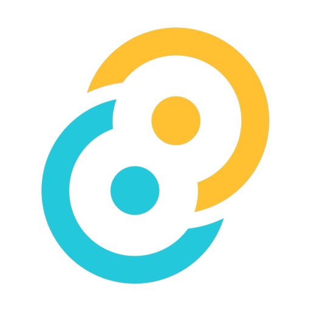

<div align="center">

<picture>
  <source media="(prefers-color-scheme: dark)" srcset="docs/assets/Axis%20Tools%20Dark.png">
  <source media="(prefers-color-scheme: light)" srcset="docs/assets/Axis%20Tools%202.png">
  
</picture>

# Axis Terrain Lab

**Next-Gen GPU-Accelerated Procedural Terrain, Splatmap & Hydraulic Erosion Suite**

[](https://github.com/MooPuu/Axis-Terrain-Lab/releases/tag/v1.0.0)
[](https://moopuu.github.io/Axis-Terrain-Lab/)
[](https://moopuu.github.io/Axis-Terrain-Lab/app/)
[](https://www.rust-lang.org)
[](https://tauri.app)
[](https://threejs.org)
[](https://headlessui.com)
[](LICENSE)
[](https://github.com/MooPuu/Axis-Terrain-Lab/releases/tag/v1.0.0)

<p align="center">
  <a href="https://moopuu.github.io/Axis-Terrain-Lab/" target="_blank"><strong>🌐 Visit Official Website</strong></a> &nbsp;&bull;&nbsp;
  <a href="https://moopuu.github.io/Axis-Terrain-Lab/app/" target="_blank"><strong>🎮 Launch Interactive Web Studio</strong></a>
</p>

<p align="center">
  
</p>

*A blazingly fast, lightweight, and modern desktop application and web studio designed for game developers, 3D artists, and environment designers. Author 16-bit/32-bit heightmaps, simulate multi-pass hydraulic and thermal erosion, generate multi-channel packed splatmaps, and export production-ready packages for Godot Terrain3D and Unreal Engine 5.*

</div>

---

## 🌟 Overview

**Axis Terrain Lab** is part of the **Axis Tools** open-source game development ecosystem. Engineered with a native **Rust + Tauri v2** architecture and an accessible **Headless UI** interface, it replaces slow, multi-gigabyte legacy terrain software with a standalone binary under **10 MB** that starts instantaneously.

Whether sculpting alpine horns, simulating millions of cubic meters of hydrodynamic virtual-pipe erosion, or packing 4-channel biome splatmaps, Axis Terrain Lab provides an interactive, real-time 3D workflow directly on the GPU.

---

## ✨ Features

### 🌊 Physical GPU Erosion Simulation
- **Hydraulic Shallow Water (Virtual Pipes)**: Real-time simulation of hydrodynamic rainfall, outflow flux conservation, velocity vectors, bedrock dissolution ($K_s$), sediment carrying capacity ($K_c$), deposition ($K_d$), and evaporation.
- **Thermal Talus & Scree**: Angle of Repose material slip ($25^\circ - 48^\circ$) modeling realistic mechanical cliff weathering and alluvial scree fans.
- **Fluvial Dendritic River Incision**: Stream power drainage routing carving natural dendritic riverbeds and canyon networks across macro-terrains.

### 🎨 Weightmap & Splatmap Generator
- **Slope Angle Mask**: Normal dot-product gradient extraction distinguishing sheer vertical rock cliffs from gentle valley meadows.
- **Curvature Mask (Laplacian $\nabla^2 H$)**: Second-order derivative filter separating exposed convex ridge weathering from concave dirt/moisture hollows.
- **Altitude Bands**: Customizable elevation thresholds for valleys, alpine treeline, and glaciated snow fields.
- **Topographic Wetness Index (TWI)**: Combines residual water depth, fluid flow velocity, and deposited silt.
- **4-Channel RGBA Packed Splatmap**:
  - **Red**: Cliff Rock & Ridges
  - **Green**: Lowland Grass
  - **Blue**: Soil Sediment & Riverbed Silt
  - **Alpha**: Glacial Mountain Snow

### 🎮 Interactive 3D Viewport & Brushes
- **WebGL2 / Three.js Renderer**: 60 FPS continuous terrain mesh rendering with real-time soft shadows, adjustable sun azimuth ($0^\circ - 360^\circ$) and elevation ($15^\circ - 85^\circ$).
- **5 Viewport Modes**: PBR Multi-Material, Elevation Heatmap, Slope Angle Overlay, Packed Splatmap RGB, and Wireframe Topology.
- **Raycast 3D Sculpting Brushes**: Sculpt directly onto the 3D surface with continuous raycasting:
  - `Raise` & `Lower` (Smooth cosine displacement)
  - `Smooth` (Gaussian / bilateral surface blur)
  - `Flatten` (Sample-locked plateau terracing)
  - `Hydraulic Stamp` (Localized riverlet carving)

### 📦 First-Class Game Engine Bridges
- **Godot 4.x / Terrain3D**:
  - Little-Endian unsigned 16-bit RAW (`.r16`)
  - Proprietary 4-channel packed **Control Map** (`.png`) encoding texture slot indices (0-31), weight blend, roughness, and wetness flags
  - Companion `terrain3d_config.json` preset
- **Unreal Engine 5 Landscape**:
  - Clamped to Epic's recommended component resolutions (`1009x1009`, `2017x2017`, `4033x4033`)
  - 16-bit Little-Endian RAW (`.r16` / `.raw`)
  - 4x Individual 8-bit layer weightmap PNGs (`Layer_Rock`, `Layer_Grass`, `Layer_Dirt`, `Layer_Snow`)
  - World Partition tiling metadata

---

## 🚀 Downloads & Installation (v1.0.0)

| Package | Description | Download | Size | SHA-256 Checksum |
|---|---|---|---|---|
| **Standalone Portable** | Zero installation. Run directly anywhere. | [**Axis-Terrain-Lab_1.0.0_Portable.exe**](https://github.com/MooPuu/Axis-Terrain-Lab/releases/download/v1.0.0/Axis-Terrain-Lab_1.0.0_Portable.exe) | ~9.12 MB | `2076D7C530FF7D7EFC79432C55BDF03359054C5C30A231A82FD60D354DE2C3E2` |
| **Setup Wizard (NSIS)** | Desktop & Start Menu shortcuts, clean uninstaller. | [**Axis-Terrain-Lab_1.0.0_NSIS_Setup.exe**](https://github.com/MooPuu/Axis-Terrain-Lab/releases/download/v1.0.0/Axis-Terrain-Lab_1.0.0_NSIS_Setup.exe) | ~2.07 MB | `4405735925931FCC5C23F026E77C09F16026D8CF380F50DE970BFB1822738D3A` |
| **Enterprise Installer (MSI)** | WiX Windows Installer package. | [**Axis-Terrain-Lab_1.0.0.msi**](https://github.com/MooPuu/Axis-Terrain-Lab/releases/download/v1.0.0/Axis-Terrain-Lab_1.0.0.msi) | ~3.03 MB | `92DA8F75E86E46301DAC986C4928303238C53AF9DC7A90789961FB9255D50E1D` |
| **Live Web Studio** | Run in your browser with WebGL2 acceleration. | [**Launch Web Edition**](https://moopuu.github.io/Axis-Terrain-Lab/app/) | Browser | — |

> **System Requirements:** Windows 10/11 (64-bit) with WebView2 &bull; Modern web browser with WebGL2 (Chrome, Edge, Firefox, Safari).

---

## 🛠️ Architecture & Tech Stack

```
Axis Terrain Lab
├── Backend (Rust & Tauri v2)
│   ├── Cargo.toml (axis-terrain-lab v1.0.0)
│   ├── tauri.conf.json (Window: 1440x900, "Axis Terrain Lab , Made By Mahdi Kareem © 2026")
│   └── lib.rs (Tauri application builder)
└── Frontend (TypeScript & WebGL)
    ├── Headless UI v2 (@headlessui/react) — Accessible Tabs, Listbox, Dialog, RadioGroup, Switch
    ├── Three.js r186 (Continuous mesh displacement, raycasting, dynamic directional lighting)
    ├── Solar & Iconsax Duotone Icon Suite (Custom vector SVGs)
    ├── TerrainEngine.ts (Fast 32-bit hydraulic & thermal simulation, Laplacian curvature)
    └── ExportPipeline.ts (Godot Terrain3D packed Control Map & UE5 Landscape exporters)
```

---

## 💻 Building from Source

### Prerequisites
1. **Node.js** (v18+) and **npm**: [nodejs.org](https://nodejs.org)
2. **Rust & Cargo** (v1.77+): [rustup.rs](https://rustup.rs)
3. **Microsoft C++ Build Tools** (via Visual Studio Installer)

### Development
```bash
# 1. Clone repository
git clone https://github.com/MooPuu/Axis-Terrain-Lab.git
cd Axis-Terrain-Lab

# 2. Install dependencies
npm install

# 3. Launch live web studio preview
npm run dev

# 4. Or launch native desktop Tauri application
npx @tauri-apps/cli dev
```

### Production Build
```bash
# Build web app
npm run build

# Compile native Windows executables & bundles (Portable, NSIS, MSI)
npx @tauri-apps/cli build --bundles nsis,msi
```

---

## 📄 License

This project is open-source and released under the **MIT License**. See [LICENSE](LICENSE) for details.

---

## 👤 Author & Credits

- **Creator & Lead Developer**: Mahdi Kareem ([MooPuu](https://github.com/MooPuu))
- **Organization**: [Axis Tools](https://github.com/MooPuu) &mdash; *The Open-Source Game Development Stack*
- Copyright &copy; 2026 Mahdi Kareem. All rights reserved.
